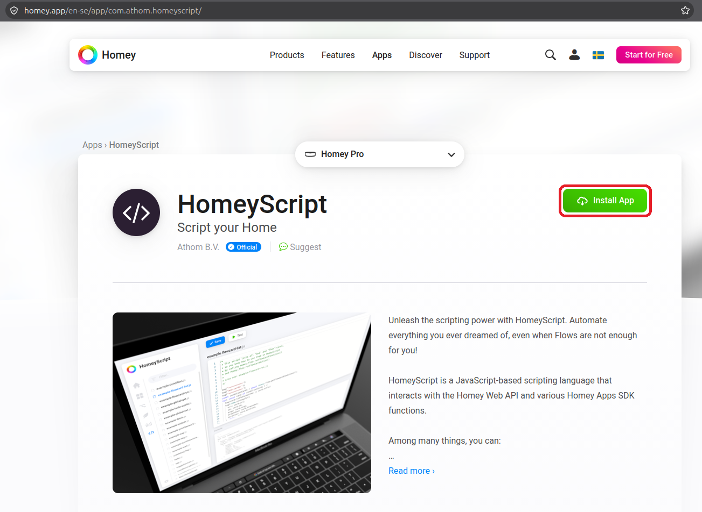
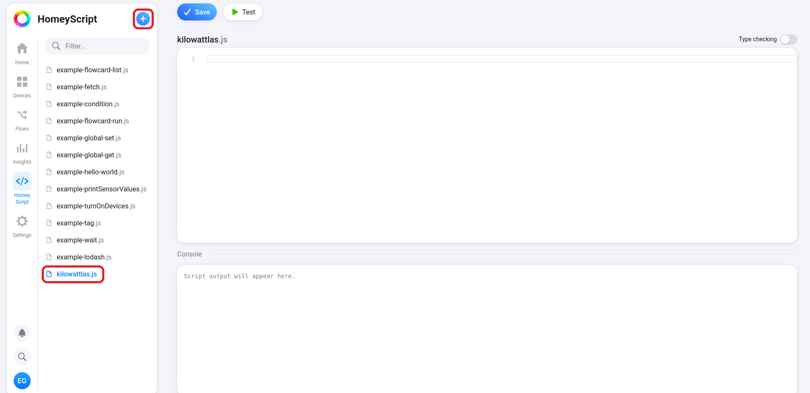
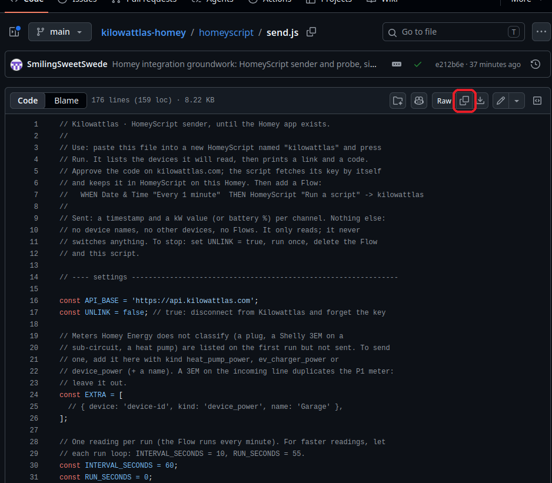
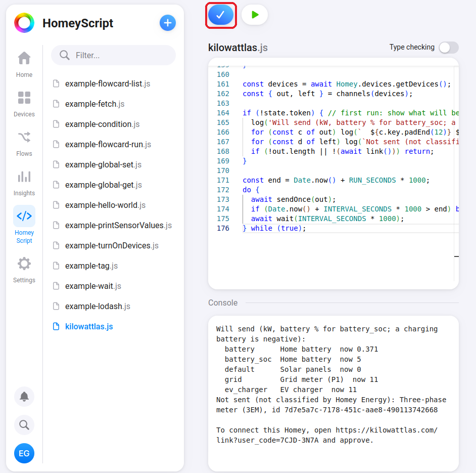
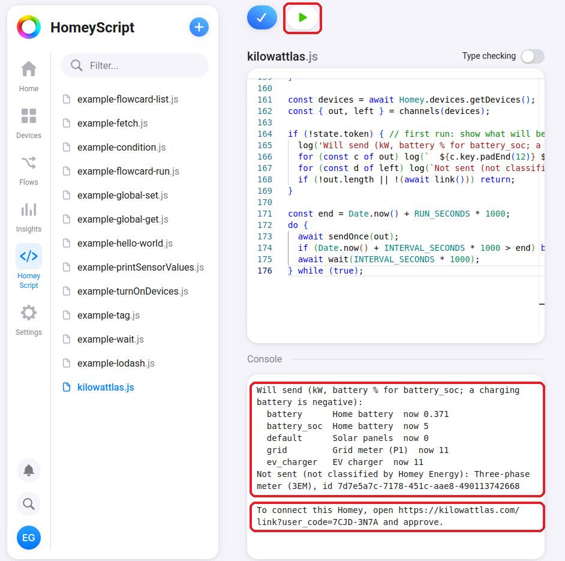
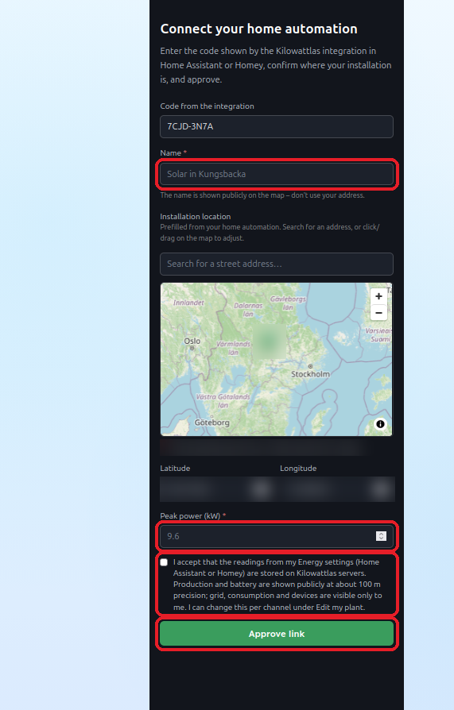
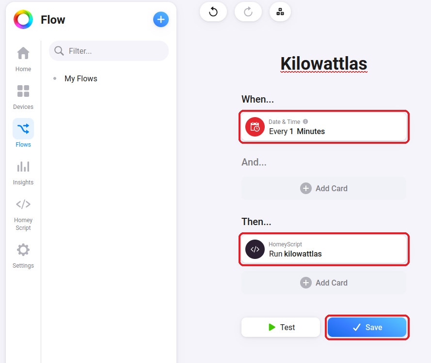
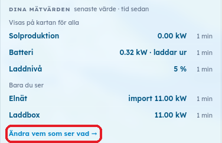

# Kilowattlas för Homey

Dela det [Homey Energy](https://homey.app/sv-se/energy/) mäter med
[Kilowattlas](https://kilowattlas.com), den öppna kartan över svensk
hemenergi. Samma sak som [integrationen för Home Assistant](https://github.com/SmilingSweetSwede/kilowattlas-homeassistant):
samma server, samma kanaler, samma regler för vad som visas.

*English: a HomeyScript that shares Homey Energy readings with Kilowattlas.
The steps below are in Swedish; developers start in
[docs/development.md](docs/development.md).*

Så här kopplar du din Homey Pro till [Kilowattlas](https://kilowattlas.com)
med appen HomeyScript. Det tar cirka tio minuter. Du behöver inte skriva
någon kod eller fylla i något i scriptet. Homeys webbsidor är på engelska,
så knapparna heter som på bilderna.

Du behöver:

- en Homey Pro (2023 eller senare) eller Homey Pro mini, med dina
  solceller, elmätare (P1), batteri eller laddbox i **Energi**-fliken,
- en dator med webbläsare,
- ett konto på kilowattlas.com (du kan skapa det under steg 5).

Kilowattlas läser bara. Det slår aldrig av eller på något hemma hos dig.

## 1. Installera HomeyScript

Öppna [HomeyScript i Homey App Store](https://homey.app/sv-se/app/com.athom.homeyscript/),
välj din Homey och klicka på **Install App**. Har du den redan, gå vidare.

## 2. Skapa ett nytt script

Öppna <https://my.homey.app/scripts/> i datorn och logga in med ditt
Homey-konto. Klicka på **+** för ett nytt script och döp det till
`kilowattlas`. Det dyker upp i listan till vänster.

## 3. Klistra in scriptet

Öppna [homeyscript/send.js](homeyscript/send.js) här på GitHub och
klicka på knappen **Copy raw file** uppe till höger i filvyn.

Gå tillbaka till scriptet på my.homey.app, klistra in (Ctrl+V eller Cmd+V)
och klicka på **Save**. I ett smalt fönster är det den blå knappen med en bock.

## 4. Kör scriptet och kontrollera listan

Klicka på **Test**, den vita knappen med en grön pil (▶). Under
**Console** visas vilka enheter scriptet hittat i Homey Energy och vad de
mäter just nu, och under dem en länk.

Stämmer listan med det du ser i Energi-fliken? Ett batteri som laddar visas
med minustecken; det är rätt. Mätare som Homey Energy inte har sorterat in,
till exempel en Shelly 3EM, står under **Not sent**. De skickas inte.

Ser listan fel ut, sluta här och skicka utskriften till oss.

## 5. Godkänn på kilowattlas.com

Under listan står en länk. Öppna den och logga in på kilowattlas.com (eller
skapa ett konto). Sidan är på engelska. Fyll i:

- **Name:** ett namn på anläggningen, till exempel "Solceller på taket".
- **Adress:** sök upp din adress eller klicka på kartan.
- **Peak power (kW):** solcellernas toppeffekt, står på växelriktaren eller
  i offerten.
- Kryssa i rutan som säger att du godkänner att mätvärdena lagras.

Klicka på **Approve link**.

## 6. Kontrollera att det fungerar

Tillbaka på my.homey.app: inom en minut skriver scriptet `Connected` och
sedan `sent 5, accepted 5, rejected 0` (antalet beror på dina enheter).
Står det `Not approved yet`, klicka på **Test** igen.

## 7. Skapa ett Flow som kör scriptet varje minut

Utan ett Flow skickas bara ett värde, när du själv klickar på Test.

På my.homey.app eller i Homey-appen: **Flows → +**, sedan:

- **When:** *Date & Time* → **Every 1 Minutes** (välj 1 och minuter)
- **Then:** *HomeyScript* → **Run** → `kilowattlas`

Lägg inga kort under **And**. Välj inte sekunder: varje körning tar en
stund, och Homey stänger av ett Flow som startar oftare än det hinner köras.

Klicka på **Save** och se till att Flowet är påslaget.

## 8. Välj vem som ser vad

Efter några minuter syns anläggningen under **Mina anläggningar** på
kilowattlas.com. Där väljer du för varje kanal om den ska synas för alla,
bara för dig, eller vara avstängd. Scriptet följer ditt val. Klicka på
**Ändra vem som ser vad**.

Som standard syns solproduktion och batteri för alla, på cirka 100 meters
noggrannhet och utan namn. Elnät och laddbox ser bara du.

## Sluta

1. Öppna scriptet, ändra `const UNLINK = false;` till `const UNLINK = true;`,
   klicka på **Save** och sedan **Test**. Kopplingen till Kilowattlas tas bort.
2. Radera Flowet och scriptet.
3. Vill du också radera historiken: ta bort anläggningen under
   **Mina anläggningar** på kilowattlas.com.

## Vanliga frågor

**Vad skickas?** En tidsstämpel och ett värde i kW (batteriets laddnivå i
procent) för varje kanal i listan från steg 4. Inga enhetsnamn, inga Flows,
inga andra enheter.

**Var finns nyckeln?** Scriptet sparar den i HomeyScript på din Homey. Den
visas aldrig och du behöver aldrig kopiera den.

**Det står `rejected` i utskriften.** Skicka utskriften till oss; den säger
vilken kanal och varför.

## För utvecklare

Hur repot är uppbyggt, simulatorn, reglerna för ändringar och checklistan
före en release: [docs/development.md](docs/development.md). Hur Homey
Energys enheter blir Kilowattlas-kanaler: [docs/energy-mapping.md](docs/energy-mapping.md).

## Licens

MIT. Inte knutet till Athom B.V.; Homey är deras varumärke.
